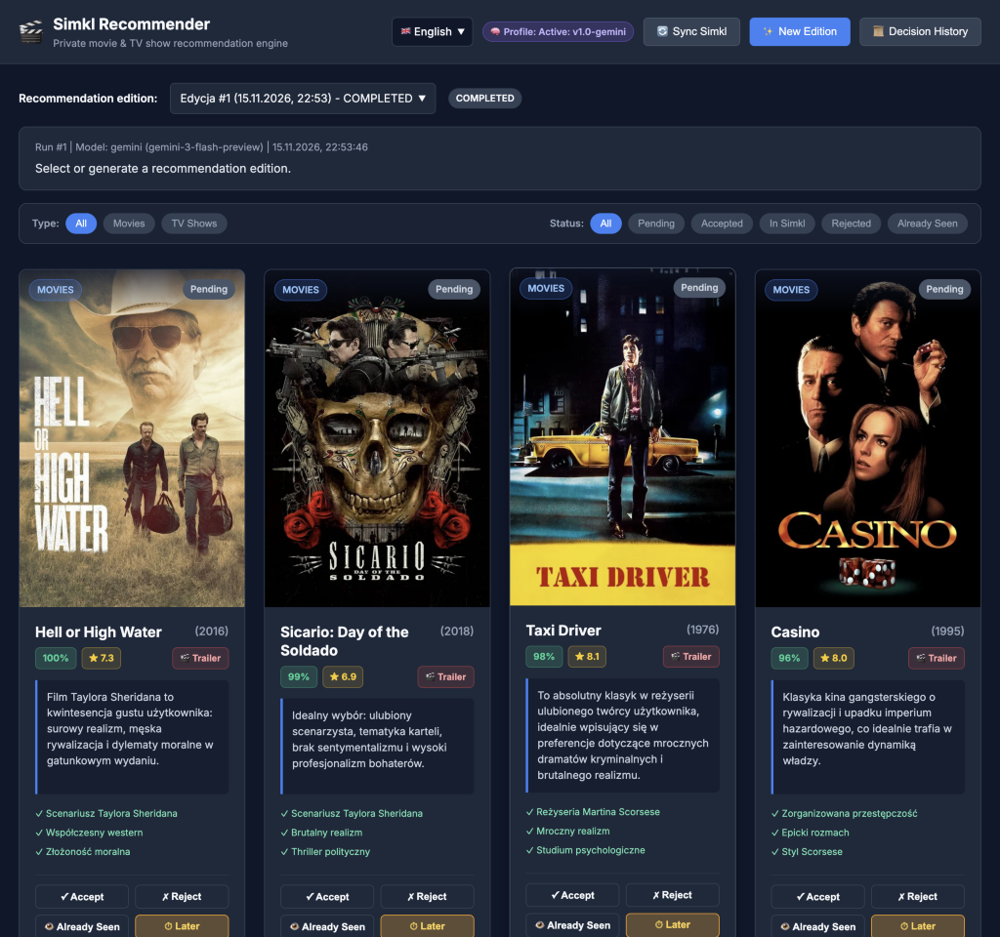
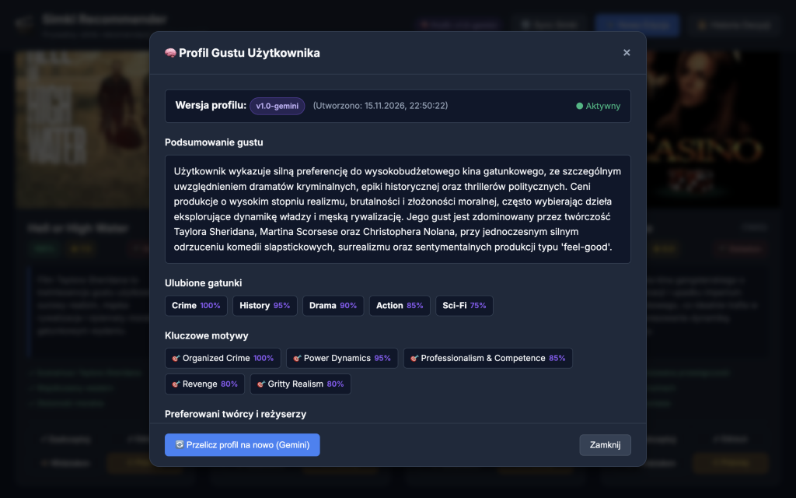

# Curato

[](https://github.com/vibowit/curato/actions/workflows/ci.yml)
[](https://www.python.org/downloads/)
[](LICENSE)

Curato is a self-hosted movie and TV show recommendation service designed for personal homelab environments. It learns from your watch history and ratings on **Simkl**, sources discovery candidates from **TMDB**, and uses LLMs (**Google Gemini** or **OpenAI**) to perform semantic scoring, risk assessment, and reasoning.

Recommendations can be reviewed through a lightweight single-page web dashboard or queried by AI assistants using the **Model Context Protocol (MCP)**.

---

## Why Curato?

Ever sat down in front of the TV after a long week, excited to watch something good, only to find yourself completely paralyzed by choice?

- **Oscar-winning lists?** A great way to get emotionally drained when all you wanted was an engaging evening.
- **Top 250 on IMDb?** Quickly reveals that the "arithmetic average of the crowd" rarely matches your personal taste.
- **Streaming homepages?** End up in 40 minutes of mindless scrolling through algorithms optimized to push whatever is trending, rather than what you actually enjoy.

Most movie pickers treat recommendations as a generic popularity contest. **Curato** was built to solve this personal frustration: it turns your actual watch history into a private taste profile, filters out everything you've already seen or disliked, and uses LLMs to surface a tight, tailored shortlist of titles you actually want to watch — with zero algorithmic bloat.

---

## Preview

### Recommendation Review & Decision Deck
Review weekly candidates scored against your taste profile, complete with tailored LLM reasoning, matching motifs, and integrated YouTube trailers:

<p align="center">
  
</p>

### Versioned Taste Profiling
Natural-language taste analysis, thematic motifs, weighted genres, and director preferences synthesized from your Simkl watch history:

<p align="center">
  
</p>

---

## Architecture and Design Principles

- **Taste profiling with provenance**: Watch history and ratings are aggregated from Simkl into versioned taste profiles (e.g., `v1.0-gemini`). Profiles capture thematic motifs, directorial preferences, and anti-preferences, while supporting manual adjustments (`v1.1-manual`) without losing provenance data.
- **Strict anti-recommendation filtering**: Titles already marked as completed, currently watching, listed on *Plan to Watch*, or previously rejected are completely excluded from subsequent candidate pools.
- **Human-in-the-loop sync**: Zero automated writes to external services. Recommendations must be explicitly accepted by the user before they can be synced to Simkl. External write operations are fully idempotent.
- **Integrated trailer previews**: Automatically extracts official YouTube trailers via TMDB Videos API and embeds them in a responsive 16:9 player on the review cards.
- **Dual MCP interface**:
  - **STDIO**: Native integration for local agentic tools such as Antigravity IDE, Cursor, and Claude Desktop.
  - **HTTP / SSE**: Authenticated Server-Sent Events endpoint for remote assistants (e.g., ChatGPT Custom Actions).
- **Concurrency in SQLite**: Runs on SQLAlchemy 2.0 with Write-Ahead Logging (`PRAGMA journal_mode=WAL`), normalized busy timeouts, and isolated session scopes, allowing the background scheduler, REST API, and MCP clients to access the database concurrently without lock contention.

```
                 +--------------------------------------------------+
                 |                     Clients                      |
                 |   Web Dashboard (SPA)  |  Antigravity / Cursor   |  ChatGPT
                 +-------------+----------+------------+------------+----+--+
                               | HTTP                  | STDIO MCP       | SSE MCP
                               v                       v                 v
                 +----------------------------------------------------------+
                 |                      Curato Backend                      |
                 |                                                          |
                 |   FastAPI REST API  •  MCP Tools  •  Background Scheduler|
                 |                                                          |
                 |   Domain Services:                                       |
                 |   - SyncService        (Simkl library & history)         |
                 |   - TasteService       (LLM profiling & versioning)      |
                 |   - DiscoveryService   (TMDB candidate sourcing)         |
                 |   - Recommendation     (Anti-filtering & scoring)        |
                 |   - WatchlistService   (Controlled Simkl export)         |
                 +-----------------------------+----------------------------+
                                               |
                     +-------------------------+------------------------+
                     v                         v                        v
            [ SQLite (WAL Mode) ]     [ Simkl API (OAuth) ]    [ Google Gemini / OpenAI ]
            Local state & runs        History & Watchlist      Semantic scoring & taste
```

---

## Quickstart (Docker Compose)

The recommended way to run Curato is using Docker Compose:

1. **Clone the repository:**
   ```bash
   git clone git@github.com:vibowit/curato.git
   cd curato
   ```

2. **Configure environment variables:**
   ```bash
   cp .env.example .env
   # Edit .env with your Simkl, TMDB, and Gemini/OpenAI API credentials
   ```

3. **Prepare the data directory (UID 1000):**
   ```bash
   mkdir -p data
   # On Linux / Proxmox host:
   sudo chown -R 1000:1000 data
   sudo chmod 775 data
   ```

4. **Start the container:**
   ```bash
   docker compose up -d --build
   ```

The service will be available at:
- **Web UI**: [http://localhost:8000/](http://localhost:8000/)
- **API Documentation**: [http://localhost:8000/docs](http://localhost:8000/docs)
- **Healthcheck**: [http://localhost:8000/api/health](http://localhost:8000/api/health)

Database migrations run automatically at startup via `entrypoint.sh`.

---

## Configuration

Settings are managed via environment variables (or `.env` file):

| Variable | Description | Default / Format |
| :--- | :--- | :--- |
| `SIMKL_CLIENT_ID` | Simkl Developer Client ID | Required |
| `SIMKL_CLIENT_SECRET` | Simkl Developer Client Secret | Required |
| `SIMKL_USER_TOKEN` | Simkl User Access Token (obtainable via `scripts/get_simkl_token.py`) | Required |
| `TMDB_API_KEY` | TMDB API Read Access Key or v3 API Key | Required |
| `GEMINI_API_KEY` | Google Gemini API Key | Required |
| `GEMINI_MODEL` | Target Gemini model | `gemini-2.5-flash` |
| `MCP_API_KEY` | Bearer token protecting `/mcp/sse` endpoints | Optional (recommended) |
| `SCHEDULER_ENABLED` | Run weekly automated recommendations in the background | `true` |
| `SQLITE_DB_PATH` | Path to the SQLite database file | `/app/data/movie_recommend.db` |
| `LOG_LEVEL` | Application logging verbosity | `INFO` |

---

## Model Context Protocol (MCP)

Curato implements the Model Context Protocol (`mcp>=2.0.0`), exposing 9 tools:

- `get_taste_profile`: Fetches the currently active taste profile and preferences.
- `get_library_stats`: Reports counts of synced items, ratings, and last sync timestamp.
- `sync_simkl`: Triggers incremental or full sync from Simkl.
- `generate_recommendations`: Runs the recommendation pipeline for a specified batch size.
- `get_recommendations`: Retrieves recommendations from a given run with scores and reasoning.
- `get_trailer`: Resolves official YouTube trailer data for a recommendation.
- `record_decision`: Saves a user review decision (`accept`, `reject`, `seen`, `later`).
- `approve_recommendations`: Exports accepted items to Simkl *Plan to Watch* idempotently.
- `get_recommendation_history`: Returns previous recommendation runs.

### Local Agents (STDIO)
Add Curato to your agent configuration (e.g., `~/.gemini/settings.json` or Claude Desktop):

```json
{
  "mcpServers": {
    "curato": {
      "command": "/path/to/curato/.venv/bin/python",
      "args": ["-m", "app.mcp.cli"],
      "cwd": "/path/to/curato"
    }
  }
}
```

### Remote Agents / ChatGPT (SSE)
- **SSE URL**: `https://your-domain.com/mcp/sse`
- **Messages URL**: `https://your-domain.com/mcp/messages/`
- **Authorization**: Bearer header with your `MCP_API_KEY`

---

## Development

Local development uses [`uv`](https://github.com/astral-sh/uv):

```bash
# Setup environment
uv sync

# Run database migrations
uv run alembic upgrade head

# Start development server
uv run uvicorn app.main:app --host 127.0.0.1 --port 8000 --reload

# Run test suite (108 tests)
uv run pytest

# Run linter
uv run ruff check app tests
```

---

## Documentation

Comprehensive project specifications, architecture design, and deployment guides:

- [Architecture & Design Principles](docs/architecture.md)
- [Product Scope & Requirements](docs/product.md)
- [Data Model & Database Schema](docs/data-model.md)
- [API Contracts & Error Format](docs/api-contracts.md)
- [Recommendation Engine Specification](docs/recommendation-engine.md)
- [Docker & Proxmox VE (LXC) Deployment Guide](docs/deployment.md)
- [Architecture Decision Records (ADR)](docs/ADR.md)

---

## License & Discussions

Curato is open source under the [MIT License](LICENSE).

This repository is maintained as a personal portfolio project and single-user deployment. GitHub Issues and Pull Requests are disabled, but **[GitHub Discussions](https://github.com/vibowit/curato/discussions)** are open for questions, ideas, and architecture discussions. You are welcome to fork and adapt the code for your own setup.
